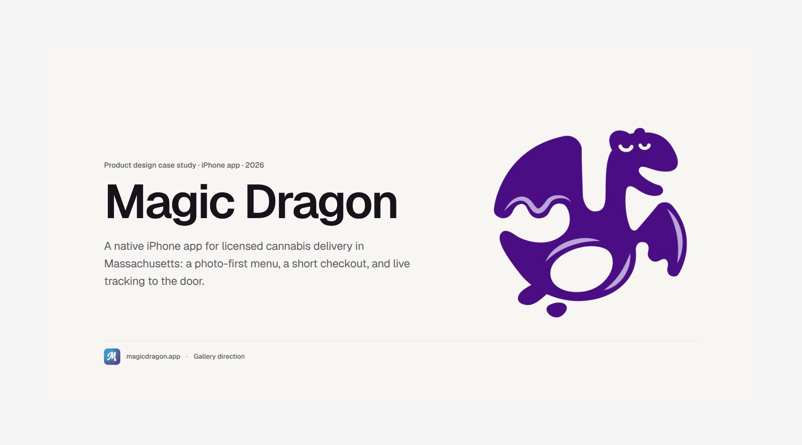
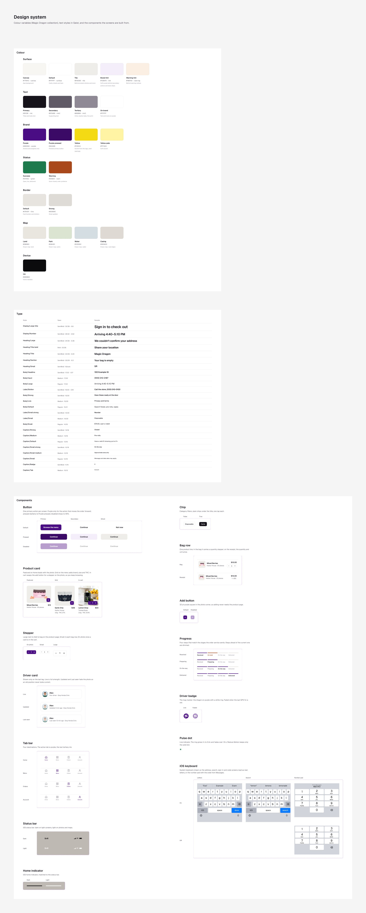
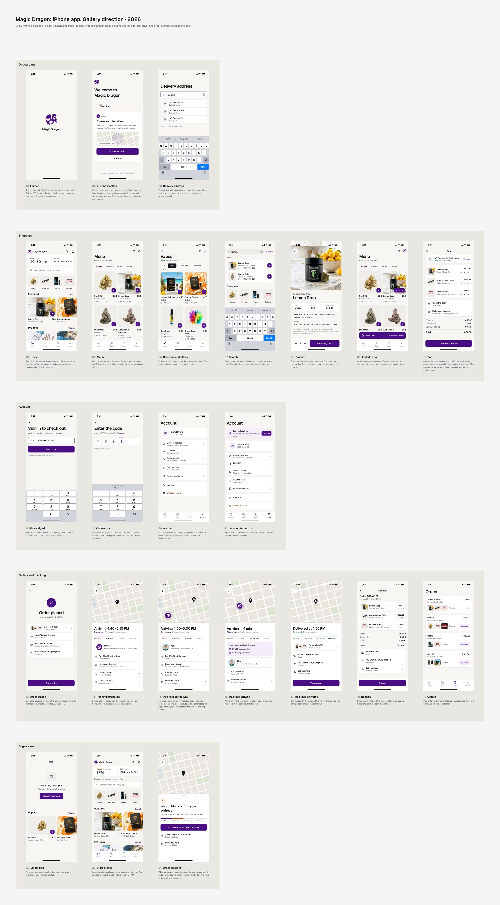
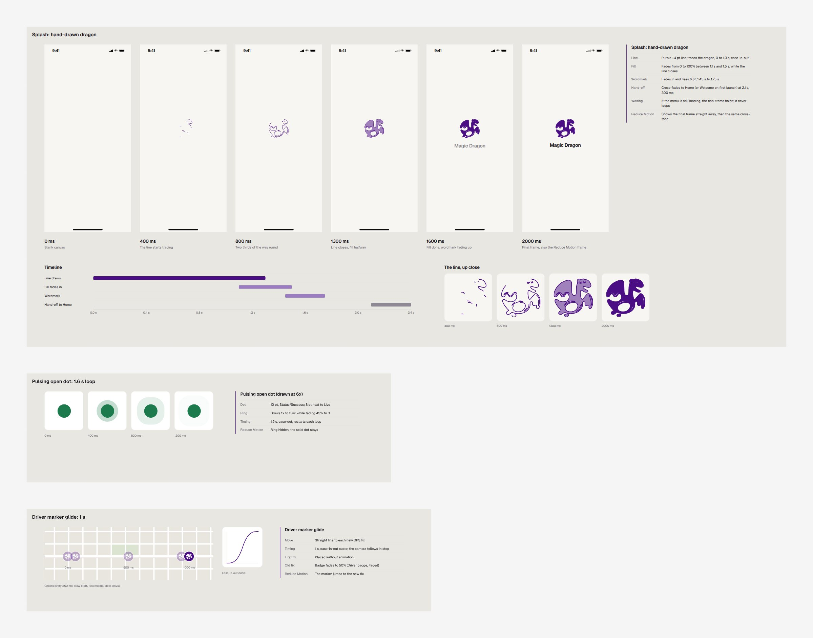
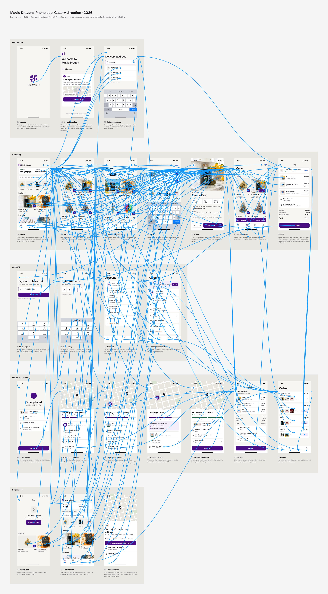

# Dave Aiello, product design portfolio

Static site, no build step. Deployed on Vercel.

```
index.html            Design (home)
work/steady/          Steady case study
prototype/steady/     Clickable prototype (?frame=<id> deep links, ?bare for 390x844 frames)
prototype/magic-dragon/  Magic Dragon iPhone app, Gallery direction: clickable prototype and the 24 screens
about/                About
development/          Development
figma/                Figma plugin that rebuilds the Steady prototype as a Figma file
figma/magic-dragon/   Figma plugin that rebuilds the Magic Dragon app as a Figma file
```

Preview locally with `python3 -m http.server 8765` and open http://localhost:8765.

## Build the Steady Figma file

The plugin creates every screen as editable layers, with color variables, text styles, components with variants, annotations, and the prototype links already wired.

1. Install the Figma desktop app. Plugins in development only run there.
2. Download this repo (Code, then Download ZIP) and unzip it.
3. In Figma, create a new design file.
4. Open the main menu, then Plugins, Development, Import plugin from manifest, and pick `figma/plugin/manifest.json`.
5. Run it from Plugins, Development, Steady screens. It takes a few seconds.
6. Select the Home frame and press Present to click through.

If the prototype changes, regenerate the plugin data and screenshots:

```
python3 -m http.server 8765 &
node figma/build.js
```

`build.js` needs Node and Playwright.

## Build the Magic Dragon Figma file

The plugin builds the Magic Dragon iPhone app (Gallery direction, 24 screens) as editable layers on four pages:

- **Cover**: title, the dragon mark and a one-line description. It is also set as the file thumbnail.
- **Design system**: the "Magic Dragon" colour variables as swatches, the text styles with samples, and 14 components, 13 of them sets with variants (Button, Chip, Product card, Bag row, Add button, Stepper, Progress, Driver card, Driver badge, Pulse dot, Tab bar, iOS keyboard, Status bar, Home indicator).
- **Screens**: every screen in sections (Onboarding, Shopping, Account, Orders and tracking, Edge cases), each with its design note underneath, built from those components and wired as the "Prototype" flow starting at Launch.
- **Motion**: poster frames and timing specs for the hand-drawn splash, the pulsing open dot and the driver marker glide.

1. Install the Figma desktop app. Plugins in development only run there.
2. Download this repo (Code, then Download ZIP) and unzip it.
3. In Figma, create a new design file.
4. Open the main menu, then Plugins, Development, Import plugin from manifest, and pick `figma/magic-dragon/plugin/manifest.json`.
5. Run it from Plugins, Development, Magic Dragon screens. It takes under a minute.
6. On the Screens page, select the Launch frame and press Present. Launch moves on by itself, then tap through; the tracking screens also advance on their own.

The app uses Geist. Geist is on Google Fonts, so Figma normally has it. If it doesn't, the plugin uses Inter instead and says so when it finishes; some lines may then break in slightly different places.

Previews of each page, drawn from what the plugin creates:

| Cover | Design system | Screens | Motion | Prototype links |
| --- | --- | --- | --- | --- |
|  |  |  |  |  |

If the Gallery screens change, copy them in again and regenerate the plugin and the previews:

```
npm install --no-save playwright sharp            # once
node figma/magic-dragon/sync.js                   # screens, prototype and resized photos into prototype/magic-dragon/
node figma/magic-dragon/build.js                  # writes figma/magic-dragon/plugin/code.js
node figma/magic-dragon/test/run.js --preview     # runs the plugin against a mock Figma API, redraws the previews
```

`sync.js` reads from `~/claude-scratch/consumer-app/directions` unless you pass another folder. New screens are picked up automatically: their titles, design notes and timed steps come from `src/gallery/direction.json`, links from each tap's `data-go`, and the section they land in from `figma/magic-dragon/screens.config.js`, which also names the colours, text styles and components. `build.js` starts its own local server; it prints which component uses, if any, had to be drawn as plain frames and why.

## Placeholders

Anything Dave still needs to fill in is marked with the `todo` class and shows with a dashed yellow outline. Search the HTML for `class="todo` to find them.
